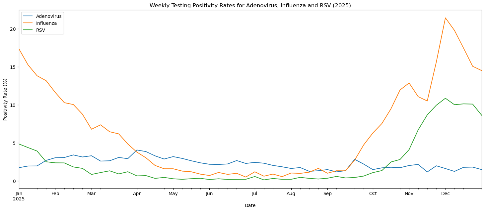
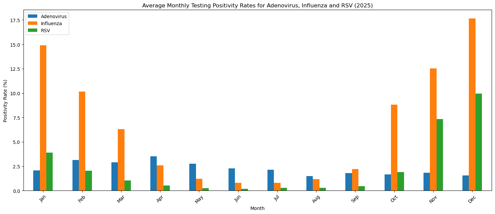
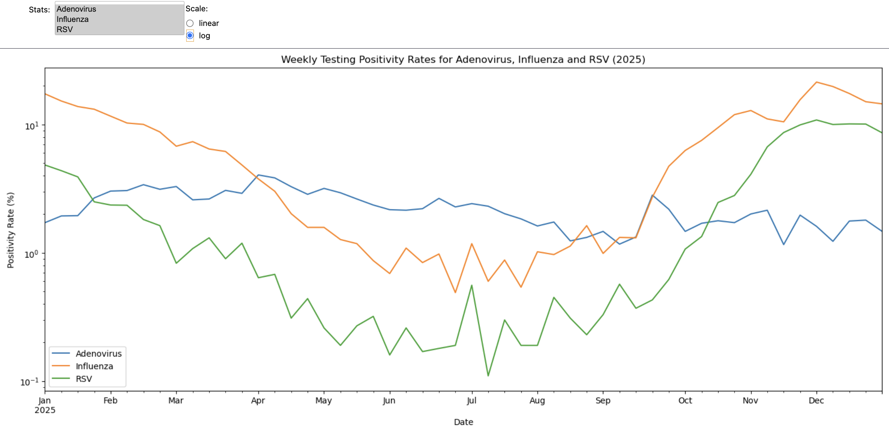
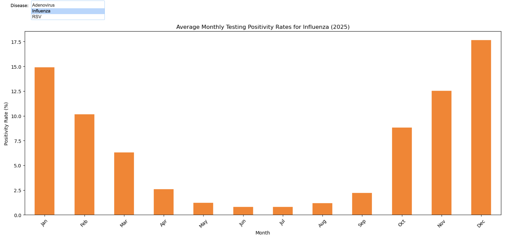

# UKHSA Disease Tracking Dashboard

**Python | pandas, Matplotlib, ipywidgets | UKHSA API | Adenovirus, Influenza and RSV in England, 2025**

I built this interactive dashboard to track testing positivity rates for three respiratory diseases in England: Adenovirus, Influenza and RSV. The notebook downloads weekly data from the UK Health Security Agency (UKHSA) API, processes it with pandas and shows weekly and monthly trends in charts that can be filtered and refreshed with live data.

The project was completed during my MSc Computer Science at Queen Mary University of London.

## What the data shows

These are weekly testing positivity rates for all ages in England, from 6 January to 29 December 2025.

- **Influenza reached the highest rate of the year.** It peaked at **21.44%** in the week of 1 December, and the December average was **17.65%**.
- **Influenza and RSV follow a clear winter pattern.** Their June–August averages were **0.93%** and **0.25%**, compared with **17.65%** and **9.94%** in December.
- **Influenza rose about five weeks before RSV.** Influenza passed 5% in the week of 6 October and RSV in the week of 10 November. Both peaked in the same week, 1 December.
- **RSV had the widest range.** It fell to **0.11%** in mid-July and rose to **10.86%** at its peak, almost 100 times higher.
- **Adenovirus stayed steady all year.** It moved between **1.16%** and **4.05%** and had no winter peak. Its highest week was 7 April.
- **Adenovirus led in spring and summer.** It had the highest rate of the three diseases for **20** weeks in a row, from 7 April to 18 August.

## Dashboard

**Weekly testing positivity**

[](images/weekly-line-chart.png)

**Monthly averages**

[](images/monthly-bar-chart.png)

**Interactive weekly chart.** Any combination of diseases can be shown, on a linear or log scale. The log scale makes the low summer values easier to read.

[](images/interactive-weekly-log.png)

**Interactive monthly chart.** One disease is shown at a time. Influenza is selected here.

[](images/interactive-monthly-influenza.png)

A single **Refresh data** button downloads the latest data from the API and updates both charts. If the API cannot be reached, the button shows "Unavailable" and the charts keep the current data.

## How it works

1. **Download.** The notebook requests the 2025 weekly positivity data for each disease from the UKHSA API. The `APIwrapper` class sends the requests page by page, limits them to three per second and stops waiting after 30 seconds.
2. **Save and load.** The data is saved to `adenovirus.json`, `influenza.json` and `rsv.json`, and the charts are built from these files.
3. **Wrangle.** The API returns seven rows for each week: six age groups and one for all ages. `wrangle_data` keeps only the all-ages rows and builds a weekly pandas DataFrame with one column per disease. A missing week would be filled with 0.0.
4. **Plot.** Matplotlib draws a weekly line chart and a bar chart of monthly averages.
5. **Interact.** ipywidgets controls choose the diseases and scale for the weekly chart and the disease for the monthly chart.
6. **Refresh.** The button downloads the data again, runs `wrangle_data` and redraws both charts without the user touching the chart controls. API errors are caught, so the dashboard does not crash.

## Data

| Item | Value |
| --- | --- |
| Source | [UKHSA data dashboard](https://ukhsa-dashboard.data.gov.uk/) API |
| Metrics | `adenovirus_testing_positivityByWeek`, `influenza_testing_positivityByWeek`, `RSV_testing_positivityByWeek` |
| Geography | England |
| Period | 2025, 52 weeks (6 January – 29 December) |
| Age | All ages |
| Measure | Testing positivity: the percentage of tests that returned a positive result |

## Repository structure

```text
ukhsa-disease-tracking-dashboard/
├── images/
│   ├── interactive-monthly-influenza.png
│   ├── interactive-weekly-log.png
│   ├── monthly-bar-chart.png
│   └── weekly-line-chart.png
├── README.md
├── adenovirus.json
├── influenza.json
├── requirements.txt
├── rsv.json
└── ukhsa_disease_tracking_dashboard.ipynb
```

The notebook contains the full dashboard. The three `.json` files hold the 2025 data used for the charts above.

## How to run the dashboard

The notebook was tested with **Python 3.12** and needs an internet connection.

1. Install the packages: `pip install -r requirements.txt`
2. Open the notebook in Jupyter and run all cells.
3. To view it as a dashboard without the code, run `voila ukhsa_disease_tracking_dashboard.ipynb`.

Running the notebook downloads the data again and overwrites the three `.json` files.

## Limitations

Testing positivity depends on how many people are tested and who is tested, so it is not a direct count of cases. The dashboard shows all ages in England only, with no breakdown by age group or region. The year is fixed to 2025 in the filters. The data is downloaded when the notebook starts, so the notebook needs the API to be available at that point; after that, the Refresh data button handles API errors. Monthly averages are calculated from weekly values, and each week is counted in the month in which it starts.

This is an independent portfolio project and is not connected to, or endorsed by, the UK Health Security Agency. It uses UK Government data published by UKHSA.
